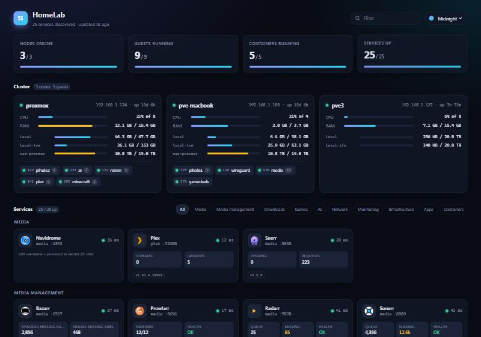

# Sett

[](https://github.com/kylechrisking/sett/actions/workflows/ci.yml)

A homelab dashboard that works out what's running by itself.

Point it at Proxmox and Docker and it finds your nodes, VMs, containers and the
apps behind their ports, then gives each one a card with its status and a few
numbers worth seeing: Sonarr's queue, Plex streams, Pi-hole's block rate,
qBittorrent's speed, that kind of thing. You don't write a services list.



## Why I built it

I ran Homepage for a long time and liked it, but my config grew to about forty
hand-written service entries and over a thousand lines of custom CSS and JS.
Every new container meant another YAML block, and half the time I forgot. Most
of what a dashboard needs is already known by something: Proxmox knows what
guests exist and their IPs, Docker knows what's published where, and the apps
themselves will tell you who they are if you ask. Sett asks.

It's one small container: plain Python with no dependencies and a vanilla JS
front end. The config is optional.

## Install

The short version, on any machine with Docker:

```bash
mkdir sett && cd sett
curl -fsSLO https://raw.githubusercontent.com/kylechrisking/sett/main/compose.example.yaml
docker compose -f compose.example.yaml up -d
```

Then open `http://<that-machine>:8099`. With just the Docker socket you'll see
that host's containers right away.

To see the whole lab, give it a read-only Proxmox token. That's two commands
on any node, and it never gets more than the PVEAuditor role. The full guide,
covering Proxmox, more Docker hosts, API keys for stats, reverse proxies,
running without Docker, and updating, is in **[docs/install.md](docs/install.md)**.

## What it knows about

About 125 apps so far, including the *arr stack, the common download clients,
Plex, Jellyfin, Emby, Immich, Home Assistant, Pi-hole, AdGuard, Traefik,
Proxmox, PBS, TrueNAS, Unraid, UniFi, Grafana, Prometheus, Netdata, Uptime
Kuma, Vaultwarden, Paperless and Nextcloud. It can also ping a Minecraft server
for its player count, and check an MQTT broker. [docs/apps.md](docs/apps.md)
has the whole list and says which cards show stats and what they need.

Anything it can't identify still gets a card with the container name and
whether it's up, so nothing you've published goes missing.

If you're already using Homepage labels on your containers (`homepage.name`,
`homepage.icon` and friends), Sett reads those. It also turns Traefik `Host()`
rules and caddy-docker-proxy labels into links, so cards point at
`https://sonarr.yourdomain` instead of an IP and port.

No Proxmox and no Docker API? Give it a subnet (`[scan] hosts =
["192.168.1.0/24"]`) and it'll go looking.

## Moving over from Homepage

```bash
docker run --rm -v /path/to/homepage/config:/in:ro -v "$PWD":/out \
  ghcr.io/kylechrisking/sett python -m sett import-homepage /in \
  -o /out/sett.toml --secrets /out/apps.toml
```

It reads your services, bookmarks, settings and widgets files. Apps Sett
can discover keep your names, descriptions and links, and their API keys go to
a separate secrets file (mode 600). `customapi` widgets turn into Sett's JSON
cards, your tabs become views, and weather, search and the clock format come
along too. I tested it against my own Homepage config and it came out very close
to what I'd ported by hand.

## Making it yours

Everything here is optional and lives in `sett.toml`.
[sett.example.toml](sett.example.toml) has every setting with comments.
Saving the file applies it within a few seconds, without a restart. If you
break the syntax, the page tells you and keeps running on the last good
version.

What you can change:

- Views, shown as tabs. I have Home, Infra and Apps, plus a Family view with
  just the shared stuff (Plex, recipes, games), which my fiancée has
  bookmarked as `?view=family`.
- Thresholds that colour a number or a word. For example, my storage card
  goes amber under 1.5 TB free and red under 500 GB.
- Which stats a card shows, in what order and under what names.
- Theme: Midnight, Daylight, Ember, Forest, or Auto to follow your device. You
  can also set your own accent colours, a wallpaper, a compact layout for
  phones, and a 24-hour clock.
- Cards for anything with a JSON endpoint, plain link cards for things
  discovery can't see, bookmarks, and weather in the header.
- Renaming, re-describing, re-linking or hiding any card that was discovered.
- Your own `custom.css` and `custom.js`. There's a slot on the page that
  Sett never redraws, so your panels stay put.

Separately, every card has a ⋯ menu to pin it to the top or hide it. That's
saved per browser, so everyone in the house can set things up their own way.

Numeric stats keep an hour of history and draw a small sparkline behind
themselves; mount `/data` and that history survives restarts and updates.
Icons are served and cached by Sett itself, so the page still looks right
when the internet is down. The page updates live as checks finish, and a card
that's down says for how long.

With a Proxmox token, node cards also show ZFS pool health, SMART results, SSD
wear, whether the last backup worked, pending updates, and a web certificate
that's about to expire. Containers with a Docker `HEALTHCHECK` that's failing
are flagged on their card and their host.

## Companion: Brock

Sett shows you what's down when you look. [Brock](https://github.com/kylechrisking/brock)
tells you when you're not looking: a small separate container that sends
alerts to ntfy, Gotify, Discord, Slack or email, with quiet hours,
maintenance windows and a status page with uptime history. Give it a Sett
API token and it watches everything Sett discovered, plus Proxmox health,
without a list of its own. Give Sett a `[brock]` section and each card shows
its uptime, as a badge, a stat or a 30-day strip. Neither needs the other.

## Security

Sett only reads. It sends GET requests to Proxmox and Docker. It logs in to
qBittorrent or Pi-hole only if you've given it credentials for stats. Secrets
stay on the server and are never sent to the browser. Sign-in is optional:
per-user passwords with optional two-factor codes, your SSO proxy's header, or
API tokens for scripts ([docs/install.md](docs/install.md#6-sign-in-and-two-factor-codes)).
Without it, run Sett on your LAN or behind your reverse proxy, the way most
people run Homepage.

## Hacking on it

```bash
python -m unittest discover -s tests -t .
```

Fingerprints are tested against real responses. [`testlab/compose.yaml`](testlab/compose.yaml)
spins up about 55 apps on a spare Docker host,
[`tools/record_fixtures.py`](tools/record_fixtures.py) records what each one
answers, and the tests replay that offline. Each app has to be identified from
its image, identified from its port alone, and not mistaken for anything else.

To add an app, `python -m sett identify http://host:port` shows what Sett
sees at an address. Most apps then need one line in `sett/apps/`.
[docs/design.md](docs/design.md) explains how the pieces fit.

## License

MIT
